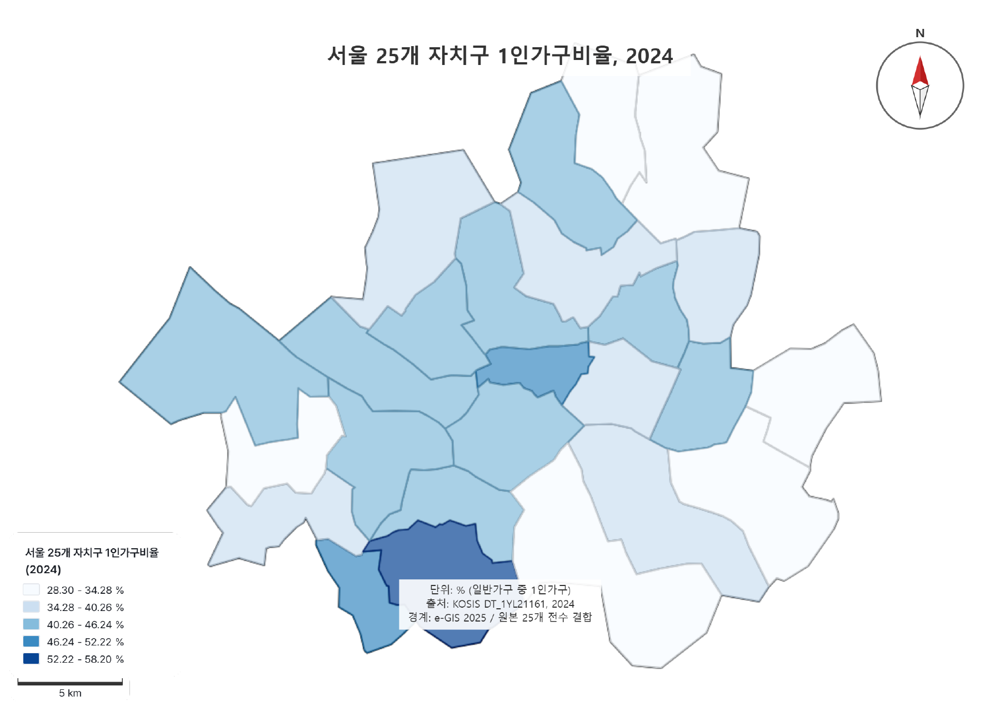
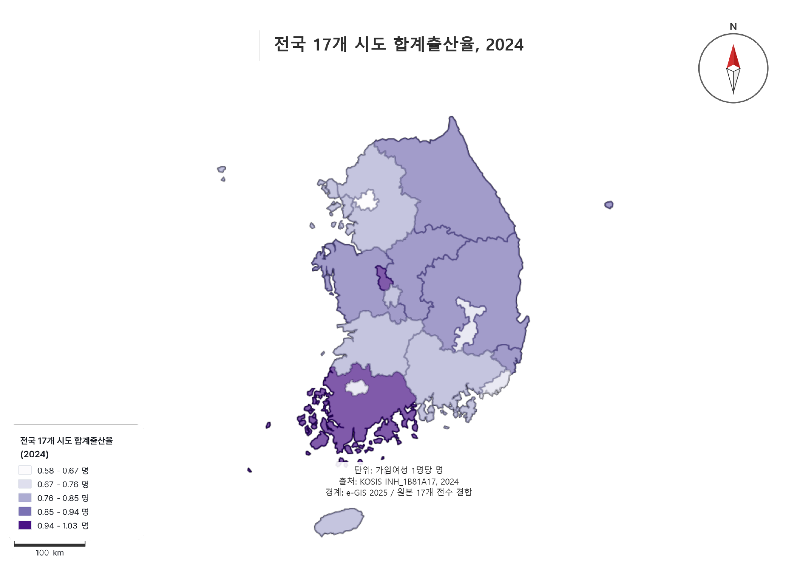

# PR #29 후속 검증 — 실제 원본에서 새 지도 2건

## SIMPLE · 한 페이지 요약

**2026-11-26, Draft 후보판 검증. 운영 사이트에는 아직 반영하지 않았습니다.**

엑셀 편집 없이 **서울 25개 자치구 1인가구비율**과 **전국 17개 시도 합계출산율**의 새 지도 제작을 완료했습니다. 실제 KOSIS 원본 → 학생 UI → CSV → e-GIS 결합 → 단계구분도 → 저장·재열기 → PDF까지 수행했습니다. 대표 이미지는 실제 PDF에서 렌더링했습니다. 원본 코드·지역명·수치와 저장·재열기 파일을 전수 대조했습니다.

1. **지역 선택**: 내 엑셀 파일로 시작합니다. 서울 시군구 또는 전국 시도를 고르거나 자동 추천을 선택합니다.
2. **원본 XLSX 입력**: KOSIS에서 2024년, 필요한 지역, 지표 하나, 코드 포함, 셀 병합 해제로 내려받은 파일을 그대로 넣습니다. 서울 사례는 서울 25개 자치구를 선택한 원본입니다.
3. **결과 확인·CSV 다운로드**: 원본과 지역 단위를 확인합니다. ‘결합 가능’일 때 CSV와 같은 범위의 실제 경계 GeoJSON을 받습니다.
4. **e-GIS 지도 제작**: 새 레이어에 GeoJSON → 레이어 선택 → ‘레이어 / 테이블 결합’에 CSV → 양쪽 `code` 연결 → 주제도 / 단계구분도에서 `T10` 또는 `value` 선택. 소수 범례, 단위·출처·연도를 적고 저장·재열기·PDF 출력을 확인합니다.

| 입력 | 이번 결과 | 지도 전 과정 |
| --- | --- | --- |
| 서울 25구 1인가구비율, DT_1YL21161/T10 | 25/25, 원본 가공 없음 | 완료 |
| **기존 INH_1B81A17 합계출산율** | 17/17, 1단 머리글 인식 수정 | 완료 |
| 대체 DT_1B8000H/T12 합계출산율 | 17/17, INH와 값 17개 일치 | UI CSV까지만 검증; 별도 지도 미제작 |
| 부산 16구군 사업체수, DT_1YL20842/T10 | 자동 부산 추천, 16/16 UI CSV | 별도 지도 미제작 |
| 기존 고령인구비율 전남22·시도17 | XLSX→CSV 회귀 22/22·17/17 | 이번에 지도 재제작하지 않음; PR #28 증거 보존 |

**범용 완료는 아닙니다.** 고정 원본 10종은 CSV 3종 성공·7종 안전 차단입니다. 기존 전국 1인가구 원본도 계속 차단됩니다. 학교 Windows·iPad·휴대전화 실기기와 어사이드 독립 수용 검사는 남아 있습니다. e-GIS PNG 버튼의 파일 수신은 확인하지 못했으며 PDF에서 만든 대표 이미지와 구분합니다.

**독립 실행 방법**: 공용 칠판의 `egis-pr29-<SHA>-review.zip` 또는 [PR 검사](https://github.com/happygeo21/school-web-projects26/pull/29/checks)의 `egis-review-<full SHA>` 아티팩트를 새 폴더에 풉니다. Node.js가 있는 PC에서 `START-WINDOWS.cmd`를 실행하고 `http://127.0.0.1:8000/kosis-egis/`를 엽니다. Mac/Linux는 `node start-local.cjs`. `CANDIDATE.json`에 정확한 커밋과 실행 파일 SHA256이 있습니다. 기존 QA ZIP의 원본을 직접 선택하며, 실행판에는 원본 검토 파일을 넣지 않았습니다. 로컬 변환에는 외부 서버·유료 API가 필요하지 않습니다. KOSIS와 실제 e-GIS에는 인터넷이 필요합니다.





## DETAIL · 재현 가능한 검증 근거

### 원본 보존과 공식 근거

어사이드의 `Codex-QA-20261126.zip`을 기존 공용 칠판에서 확보했습니다. ZIP SHA256은 `1b03cc953a54e44c4958039f7c1e917bc0992bf95915f26364ada7ce67f36453`. 포함 명세 73개 파일의 해시가 모두 일치했습니다. 원본 XLSX 10종과 공식 원문을 다시 내려받거나 편집하지 않았습니다. 첨부 문서는 검증 자료로 사용했고, 문서 안의 모니터링 제안은 실행 지시로 취급하지 않았습니다.

과거 `kssc.kostat.go.kr` 인증서 오류를 우회하지 않았습니다. 공식 새 도메인 [통계분류포털](https://kssc.mods.go.kr:8443/)의 정상 TLS와 공식 자료실 게시물 72번을 실제 브라우저로 확인했습니다. [기준시점별 분류 자료실](https://kssc.mods.go.kr:8443/ksscNew_web/kssc/common/CommonBoardList.do?categoryMenu=011&gubun=1&strBbsId=kasctnr&strCategoryNameCode=019)의 공식 첨부 경로와 보존 파일을 대조했습니다.

| 공식 보존 파일 / 기준시점 | SHA256 | 사용 근거 |
| --- | --- | --- |
| KSSC_20241231_original.xlsx / 2024-12-31 | `23b7589e9b7b7b73ed0c48d4aff4163f28df2b5186e918617178a1b47aa82bc0` | 2-2 행정동·법정동 연계표 |
| KSSC_20250101_original.xlsx / 2025-01-01 | `11ba74f7492eefe2ef02016719d09f93e076162fa35ca5aed1771526876ebe4d` | 같은 상위 구역 코드·범위 연속성 |
| KSSC_20261001_original.xlsx / 2026-10-01 | `06f899f0a7cb4caf92de880e2a4071f88ab2324dde75c985b9863f06b296a9dd` | 변경내역 중 2025 시행 항목 확인; 2026 분류로 대체하지 않음 |

확보일은 모두 2026-11-26입니다. 출처 URL·기준일·해시·다운로드일·원본 행 번호는 [registry](../../../kosis-egis-tool/region-registry.json)와 [공식 연계 감사](official-linkage-audit.json)에 있습니다. [공식 이용조건](https://kssc.mods.go.kr:8443/ksscNew_web/kssc/common/copyright.do?gubun=1)은 **공공누리 제3유형(출처표시·변경금지)**입니다. 제한 없는 라이선스로 표시하지 않습니다. 원문 파일은 바이트 그대로 별도 보존하고 실행판에 넣지 않았습니다. 엔진에는 코드·이름·연계 사실 및 원문 위치를 인용하며 원문 문서의 개작본을 배포하지 않습니다. 향후 원문 재편집·재배포는 이 기록만으로 허용된다고 해석하지 않습니다.

### 코드 연결과 공간 범위는 별도 검사

공식 연계표의 281개 상위 구역(시도17·시군구252·상위시12)을 비교했습니다. 2024말/2025초의 코드·명칭·부모 시도·행정기관/법정동 연계가 일치합니다. 2025 시행 15개 변경내역은 시군구 내부 동·리 변경으로 검토했습니다. 원문 841행에 2026 행정구역 명칭과 2025 시행일 정정이 같이 기재된 항목도 감사 JSON에 보존했으며, 이를 2026 일반구 경계의 2024 사용 근거로 삼지 않았습니다.

실제 e-GIS 경계 속성과 **시도17·시군구252 모두 코드·이름·부모를 대조**했습니다. 12개 상위 시는 일반구에 값을 복제하거나 평균하지 않습니다. 세종은 시도29→36, 기초단위29010→36110을 각각 공식 행과 실제 경계 속성으로 확인합니다. 통계코드36(전남)을 지도코드36(세종)으로 연결하거나 통계코드11110(노원)을 지도코드11110(종로)으로 연결하지 않습니다.

지도 파일 해시는 sido `6be5d0089314a73783846dff2f7342682d588ebc1729de1e3a366d3c465c1265`, sgg `ed06f5c3489d1cdb3a744a7b1152d8c2308e2d9a609f5561f3d2dd3184654802`입니다. 해시 검사는 사용자가 검증한 경계 파일을 실제 사용하는지 확인하는 것입니다. 통계연도와 경계연도 사이의 좌표 완전 동일성을 요구하지 않습니다. 실제 비교 범위·상위시/일반구·개편 유효시점이 맞아야 합니다. 적용 범위는 **2024 연간 통계 + 해당 2025 경계**이며 읍면동·다른 연도·2026 개편 분류에는 확대 적용하지 않습니다.

표별 `tableBindings`는 기관·표ID·지역분류·연도·검증된 주지표·설명·단위를 식별합니다. 지역 대응은 하나의 `standardSets`와 공통 엔진을 사용합니다. 미지의 표 전용 분류를 이름으로 공통 코드에 끼워 넣지 않습니다. registry의 `approved`는 개발 검증 상태이며 교사의 병합·배포 승인을 뜻하지 않습니다.

### 구조 분석과 실제 e-GIS 수정 근거

- 물리 셀은 있는데 `!ref=A1:A1`인 XLSX도 원본을 바꾸지 않고 읽습니다. 행·열 상한은 유지합니다.
- 1단 머리글은 공식 메타정보의 단일 지표 설명으로 식별하고, 여러 값 열에 항목이 없으면 차단합니다. 2~4단 머리글과 계층형 항목 경로를 공통 구조로 읽습니다.
- 평면 지역 표는 공식 코드로 부모를 확인합니다. 이미 원본에 부모가 있으면 별도로 일치해야 합니다. 범위 밖 행도 먼저 검증하며 미확인 코드가 있으면 제외하지 않고 차단합니다.
- 표·항목·연도·단위·상위 지역·중복·누락·경계해시·결측 차단을 유지합니다. 실제 0은 보존하고 결측은 0으로 바꾸지 않습니다.
- 실제 e-GIS CSV 결합에서 숫자로 시작한 설명이 `parseFloat`로 잘리는 문제를 발견했습니다. `1인가구…`와 `2024-12-31` 설명은 CSV에서 `통계표: …`, `KSSC 기준 …`으로 표시해 저장·재열기 후에도 설명을 보존했습니다. 통계값은 수정하지 않았습니다.
- 학생 화면은 기존 4단계를 유지합니다. 기술 열은 DETAIL로 옮겼고 실제 관찰한 e-GIS 메뉴·소수 범례·저장/재열기 경로로 안내를 보완했습니다.

### 원본 10종 결과와 기존 원본은 분리

| 고정 사례 | 파싱 원본 행 | 자동 CSV | 원인·남은 검증 |
| --- | ---: | --- | --- |
| A 서울 1인가구비율 | 26 | 25/25 UI 성공 | 서울 합계 제외; 실제 지도 전 과정 완료 |
| B DT 합계출산율 | 17 | 17/17 UI 성공 | INH와 전수 값 일치; 별도 지도 미제작 |
| C 강원 인구증가율 | 19 | 차단 | 홍천32310 등 표 분류가 공식 KAC32510과 다름; 연계 근거 미확보 |
| D 경북 청년인구비율 | 23 | 차단 | 포항 상위 시 합계와 일반구 지도 불일치 |
| E 전국 의사수 | 247 | 차단 | 통합 분류12 및 논리 기초단위229와 경계252 차이 |
| F1 시도 문화시설 | 17 | 차단 | 1224·1236 표 분류의 시점별 연결 미확인 |
| F2 시도 도시공원 | 17 | 차단 | 동일 분류 문제; 분모는 도시지역 인구이며 총인구로 바꾸지 않음 |
| G 시도 주택보급률 | 17 | 차단 | 표 전용 영숫자 코드; 1단 머리글 파싱은 성공 |
| H 부산 사업체수 | 17 | 16/16 UI 성공 | 자동 부산/시군구 추천; 별도 지도 미제작 |
| I 전국 노후주택 | 247 | 차단 | 통합 분류·상위시/일반구 차이, 집계 결측 보존 |

**기존 INH 원본**은 별도로 18행→전국 합계 제외→17/17 실제 지도 성공입니다. **기존 전국 1인가구 원본**은 서울 범위를 선택해도 248행 중 미확인 통합 분류 때문에 계속 차단합니다. 서울만 내려받은 A 원본 성공으로 기존 실패를 대체하지 않았습니다. **기존 문화시설 서울4구 원본**은 일부 지역을 명시 선택할 때 4/4 엔진→CSV 전수 대조까지 통과했습니다. 그 파일의 전체 서울25 범위 사용은 누락으로 차단합니다.

모든 고정 원본의 통계 셀을 Node.js 공통 엔진에서 물리 셀과 비교했습니다. UI 파일 선택·변환·다운로드는 A/B/H 및 기존 INH를 직접 수행했습니다. 차단 7종의 이번 검사는 엔진 검사이며 7종 모두를 UI로 재실행한 것은 아닙니다. [전수 결과 JSON](validation-results.json)에 파일별 SHA256·행수·셀수·중단 원인·검증 단계가 있습니다. 새 CSV와 실제 브라우저 다운로드는 **바이트까지 동일**하며, 실제 e-GIS 저장·재열기 각 2개 레이어의 모든 값·지역명·원본 코드·연도·단위·출처가 일치합니다. 재열기 전후 해당 프로젝트의 도형 보존도 확인했습니다.

### 실제 지도 산출물

| 사례 | CSV | 저장 | 재열기 | 원본-출력 전수표 |
| --- | --- | --- | --- | --- |
| A 서울25 | [CSV](artifacts/egis_DT_1YL21161_2024_11.csv) | [EGIS](artifacts/PR29_A_Seoul25_2024.egis) | [재열기 EGIS](artifacts/PR29_A_Seoul25_2024_reopened.egis) | [25개 전수표](artifacts/A-cell-audit.csv) |
| B 기존 INH17 | [CSV](artifacts/egis_INH_1B81A17_2024_all.csv) | [EGIS](artifacts/PR29_B_INH_Sido17_2024.egis) | [재열기 EGIS](artifacts/PR29_B_INH_Sido17_2024_reopened.egis) | [17개 전수표](artifacts/INH-existing-cell-audit.csv) |

두 PDF 원본은 공용 칠판의 지도 결과 ZIP으로 제공합니다. 파일 SHA256은 결과 JSON에 있습니다. 이미지 위 제목·범례·단위·출처·2024 통계/2025 경계 표시는 렌더링 후 눈으로 확인했습니다. 범례는 e-GIS가 제공하는 소수2자리 표기이며 원본 합계출산율의 소수3자리 숫자는 CSV와 프로젝트에 그대로 보존됩니다. PNG 버튼 다운로드 미관찰을 PNG 직접 출력 성공이라고 보고하지 않습니다. 출력 제목은 프로젝트 재열기 후 별도로 입력했습니다.

### 재현·자동 검사와 실행판 범위

```text
npm test --prefix tests/kosis-egis
node docs/kosis-egis/pr29-student-validation-20261126/build-registry.cjs EXTRACTED_QA
node docs/kosis-egis/pr29-student-validation-20261126/audit-originals.cjs EXTRACTED_QA UI_DOWNLOAD_DIRECTORY
node scripts/build-kosis-review.cjs NEW_OUTPUT_DIRECTORY
```

첫 명령은 회귀 **186개 통과**(기존167+공통 레지스트리19)입니다. 기존 고령인구 원본2종·공식 응답 대조 39값과 안전장치 검사를 포함합니다. 둘째 명령은 보존 공식 코드 원문에서 registry를 재현합니다. 셋째 명령은 QA ZIP의 원본과 실제 e-GIS 다운로드를 필요로 하며 성공·차단을 모두 검사합니다. 넷째 명령은 미커밋 변경이 있으면 정확한 커밋 실행판 생성을 거절합니다. 개발용 `--working` 산출물은 미커밋이라고 표시합니다.

CI는 Linux Chromium/Windows Edge의 기존 자동 브라우저 검사를 유지하고, **PR head SHA**를 직접 checkout한 별도 실행판을 만듭니다. 검사 결과는 해당 커밋의 Actions에서 확인합니다. 기존 Pages 운영판과 로컬 후보판의 결과를 합치지 않습니다. 단위 검사·자동 브라우저·실제 e-GIS 조작·학교 실기기·어사이드 독립 QA는 각각 다른 검증입니다.

실행판 공개 파일은 기존 허용 목록 중 변환기·학생 안내 24개뿐입니다. 테스트 입력 XLSX, 공식 원문, QA ZIP, 개인정보, 학생 DB, 키를 포함하지 않으며 `127.0.0.1` 정적 서버만 제공합니다. 원본 검토 파일은 별도 보존합니다. PR #28·main·운영 Pages·Netlify·학생 제출 폼·평가계획·동결 프로젝트는 변경하지 않았습니다.

### 다음 수용 조건

어사이드가 동일 SHA 실행판에서 A와 기존 INH를 독립 재현하고, 학교 Windows·iPad·휴대전화에서 파일 선택·CSV 다운로드·e-GIS 저장/재열기·PDF/대표 이미지 확보를 확인해야 합니다. C/F/G의 표별 코드 연계 근거, D/E/I의 같은 공간 범위 경계가 확보되어야 지원을 확장합니다. 현재 검증되지 않은 표를 무조건 변환하지 않습니다. main 병합과 운영 배포는 교사 별도 승인 대상입니다.
