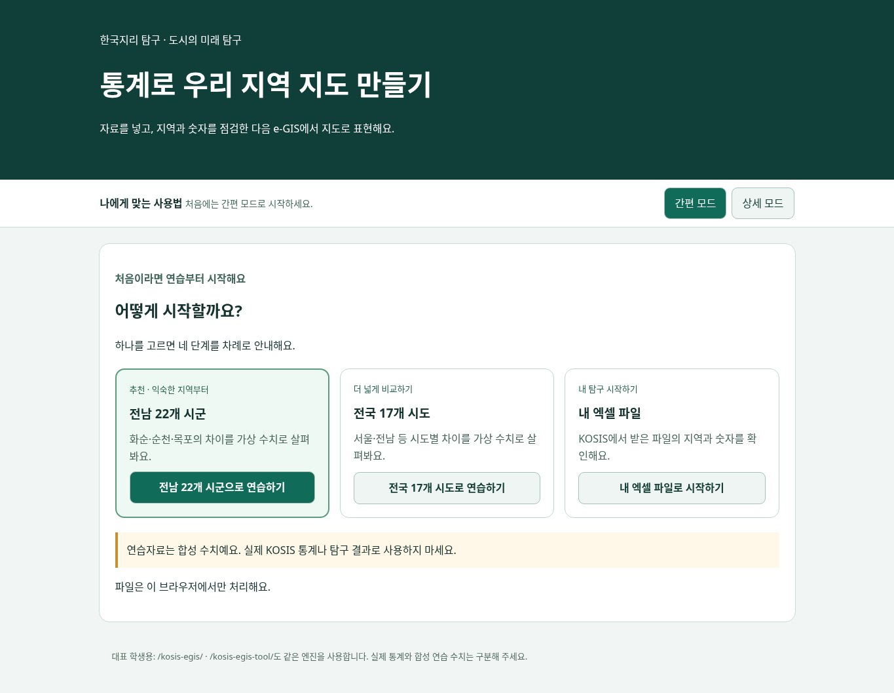
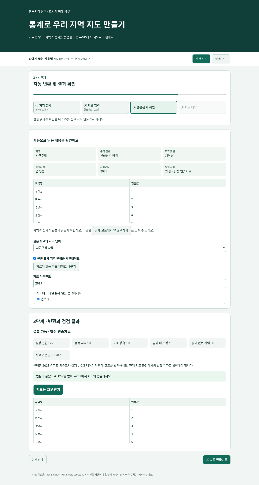
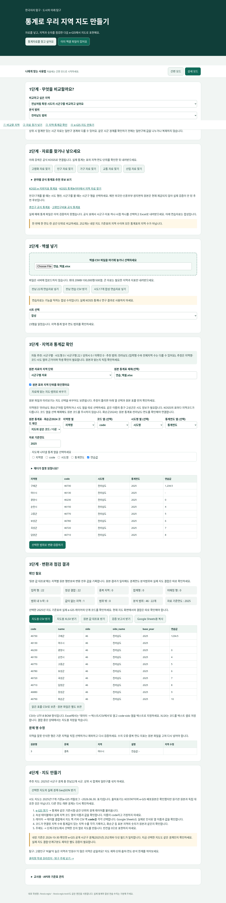
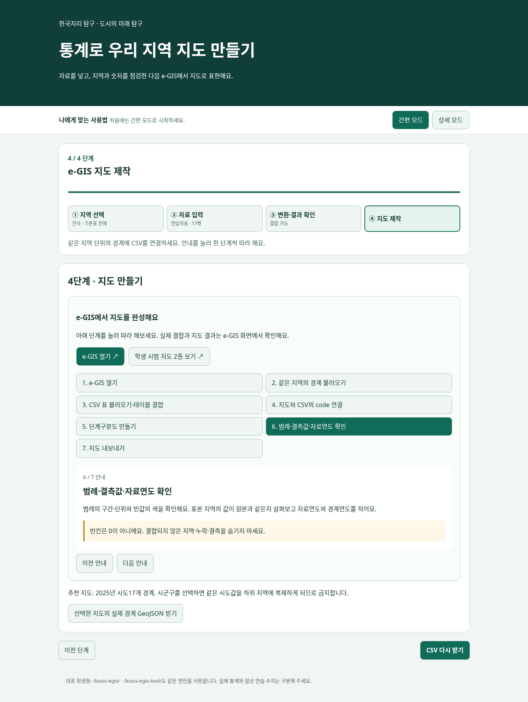
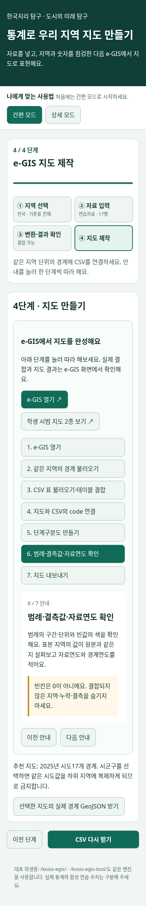

# PR #9 학생용 간편·상세 모드 최종 점검

작업 시작 HEAD `59759f612135b18ec0a3a26cbf787c00379b4973`, 기존 운영 main `ae58cdfba767af43995dc75cf1ca104b8e1ddebc`. 검증일2026-10-30 KST. [기존 PR #9](https://github.com/happygeo21/school-web-projects26/pull/9)를 개선했으며 **자동 병합·운영 배포는 하지 않습니다**. 이번 화면은 PR 소스/로컬 키트에서 검토하며 기존 운영 URL은 승인 전 그대로입니다.

## 학생이 누를 순서

1. 전남22개 시군 연습 / 전국17개 시도 연습 / 내 엑셀 중 하나를 고릅니다. 연습은 합성값입니다.
2. ① 지역 선택에서 분석할 지역을 확인하고 다음으로 갑니다. 연습의 지역은 해당 자료와 같게 고정됩니다. 내 파일의 지역을 모르면 자동 추천을 사용합니다. 연습 뒤 처음 선택으로 돌아와 내 엑셀을 고르면 새 파일을 넣기 전에는 이전 연습자료로 넘어가지 않습니다.
3. ② 자료 입력에서 연습자료 또는 내 파일을 준비합니다. 엑셀의 자료 시트가 여러 개면 시트를 고릅니다.
4. ③ 자동 분석에서 지역·분석범위·통계값 열·자료연도와 원본 미리보기를 확인합니다. 지역 단위 확인에 체크하고 변환합니다. 연도가 없거나 단위가 불명확하면 추가 확인을 요구합니다.
5. 결과의 누락·중복·빈칸·연도 안내를 읽고 **CSV 받기**를 누릅니다. ‘CSV 받고 지도 만들기’로 이어갈 수도 있습니다. 잘못된 지역/값이면 CSV를 차단하고 상세 모드로 이동해 수정합니다.
6. ④ 지도 제작에서 같은 지역 단계의 실제 경계 → CSV 불러오기 → code 결합 → 단계구분도 → 범례/결측/연도 → 내보내기 순서를 클릭해 확인합니다.

간편 모드는 현재 단계만 보여주며 앞 단계는 상단의 작은 요약으로 접습니다. 이전/다음과 단계 버튼, 현재 단계·진행률을 제공합니다. 완료된 작업을 상세 모드로 전환해도 파일·시트·열 선택·연도·수정 내용·결과를 새로 만들지 않습니다.

## 보존한 정밀 기능

지역코드 확인/수정, 헤더·시트·지표 선택, 중복·누락·결측 검사, 원본값 대조, CSV/XLSX/JSON과 교사용 고급 설정을 그대로 제공합니다. 지역 열·중복 지표 등을 간편 모드에서 덜 보이게 했지만 선택한 값과 검증 이슈는 삭제하거나 자동 제외하지 않습니다. 빈칸과0은 구별하며, 확인 필요 결과에는 안내를 유지합니다. 상세 모드에서 입력/선택을 바꾸면 기존 결과 다운로드를 무효화해 다시 검증하도록 합니다.

`core.js`, `spatial.js`, `conversion-worker.js`, 시도17·시군구252 기준표는 운영 main과 바이트 동일합니다. `app.js`에는 기존 분석/변환 상태를 화면에 알리는 이벤트만 추가했습니다. 새 변환 엔진이나 지역코드 치환 규칙을 만들지 않았습니다. 공유 `student-flow.js`가 두 URL의 같은 입력 요소와 다운로드 버튼을 이용합니다.

## 지도 안내와 외부 링크

e-GIS 공식 URL: https://www.e-gis.kr/

사용자가 제공한 학생 시범 지도2종: https://app.notion.com/p/3ce2f3db0c734467bc2b88cb4d7176e8

링크 주소·새 창/보안 속성과7개 안내 화면의 표시/이동을 자동 검사했습니다. 사용자 제공 Notion 예시의 내용·공유 권한을 독립 검증한 것은 아닙니다. 이번 작업에서 실제 KOSIS 원본 수치나 e-GIS 지도 결과를 검증했다고 표시하지 않습니다.

## 검사 결과

| 항목 | 판정·범위 |
|---|---|
| A 전남22개→CSV | 통과, 합성값22개/5자리 코드 전수 비교 |
| B 시도17개→CSV | 통과, 합성값17개/2자리 코드 전수 비교 |
| C 엑셀 입력·필수 확인 | 통과, 실제 XLSX 형식의 **합성값 파일**로 지역·지표·연도 자동 인식/결측/0 확인. 공식 KOSIS 원본 파일은 미확보·미검증 |
| D 간편↔상세 보존 | 통과, 업로드 파일명·시트·연도·선택 통계열·결과 CSV 동일 |
| E 오류 수정 | 통과, 코드/지역명 충돌 시 CSV 차단→상세에서 수정→재검증 후 같은 자료로 다운로드 |
| F 반응형 | 통과,1365/834/390/320px에서 두 모드·단계 표시·가로 넘침 검사. 실제 기기/학생 이해도 관찰은 별도 |
| G 지도 안내 | 통과,7단계 이동·code/경계/범례/내보내기 안내·공식/사용자 제공 Notion 링크 표시 |
| 기존 화면 회귀 |18개 통과, 전국252·동명이·상위시·Hwasun 사용자 기준·잘못된 코드 차단·CSV/XLSX 등 |
| 엔진·공간·보안 | 기존28+27+4개 통과 |
| 기존 다른 앱 회귀 |3개 파일 통과, 다른 앱의 공개82개 파일 바이트 동일 |
| 공개 후보 |103개 allowlist·원본 바이트·참조 검사 통과. UI 파일1개만 추가, 기존 공개 파일 삭제 없음 |
| Windows 키트 | 공유 UI 파일 포함 재생성·64개 파일 해시 확인. 최신 Windows CMD/Edge CI는 PR #9 실행 근거 참조 |

새 간편 화면9개+기존 상세 화면18개=총27개 브라우저 시나리오입니다. 외부 네트워크는 차단한 로컬 검사이며 실제 학생 관찰과 공식 통계 원본 검증을 대체하지 않습니다. 최신 Linux·Windows/Edge CI와 최종 SHA·KST는 PR #9 본문에 기록합니다.

재실행: `npm --prefix tests/kosis-egis test`, `npm --prefix tests/kosis-egis run test:browser`, `node scripts/build-public-site.mjs`, `node scripts/verify-public-site.mjs`. 기존 `_site`는 보존해 옮긴 후 빌드합니다. `KOSIS_REVIEW_OUTPUT`으로 스크린샷 저장 위치를 정할 수 있으며 기본은 임시 폴더입니다. 기존 화면 캡처를 덮어쓰지 않습니다.

## 화면

### 간편 시작 화면

### 간편 분석·결과 화면

### 상세 모드

### e-GIS 클릭형 안내

### 모바일 안내

## 배포 준비·운영 보호

코드·로컬 자동 검사 기준으로 검토 가능한 상태입니다. 실제 운영 main/Pages·Firebase·학생자료·Netlify 설정/잠금·다른 앱·legacy는 변경하지 않습니다. 승인 전 PR #9는 병합하지 않으며 새로운 PR을 만들지 않습니다. Netlify Deploy Preview/CI가 PR 푸시로 동작할 수 있지만 잠금 변경이나 운영 수동 배포를 수행하지 않습니다.

Notion 연결 도구가 없어 외부 운영 기록을 직접 갱신하지 않았습니다. 기존 eGIS 항목/변경로그에 붙여넣을 문구:

> 2026-10-30 KST / PR #9 학생용 간편4단계·상세 모드 보존·e-GIS7단계 안내 개선. 기존 코어/공간 검증/기준표 유지. 로컬 기존18+간편9개 화면 검사, 기존 엔진28·공간27·보안4 및 다른 앱 회귀 통과. 공식 KOSIS 실제 원본·학생 독립 사용은 미검증. 운영 배포/병합 없음, 별도 승인 대기. 최신 커밋·CI·화면: https://github.com/happygeo21/school-web-projects26/pull/9 . Notion 직접 반영 미수행.
