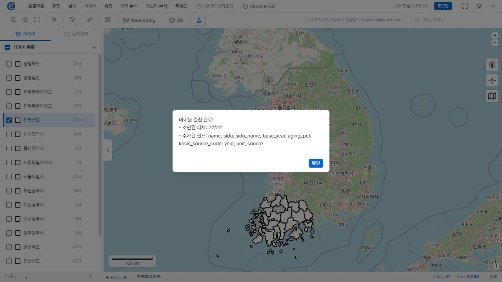
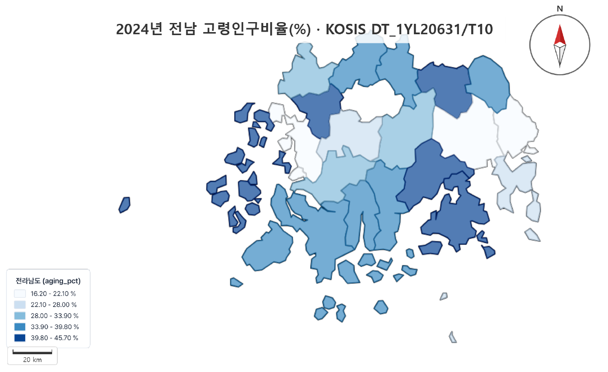
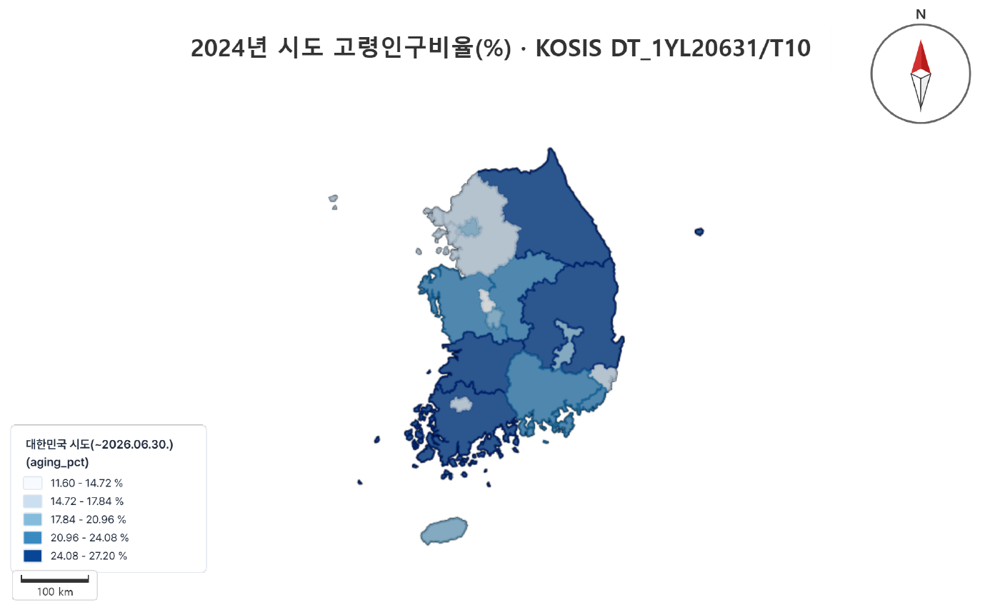

# PR #28 최종 검증 — 조건부 사용

검증 시각: 2026-11-13 19:48 KST. 검토한 기능 HEAD: `87defe1fdd9a03b87d6b864d95c181fb2b65370c`, 기준 main: `e99163fa954d2e1ba90b25a298f87f840f5a372d`. 이번 후속 변경은 증거·문서·저장 파일 감사 코드뿐이다. PR은 Draft 유지, main 병합·Pages/Netlify 배포 없음. 이 문서를 포함한 최종 문서 커밋은 PR 이력에서 확인한다.

## 실제 e-GIS 전남 22개

데스크톱 ChatGPT 내장 브라우저에서 https://www.e-gis.kr/ 의 실제 UI를 조작했다. 로컬 지도 렌더링으로 결합을 대신하지 않았다.

1. 데이터 불러오기 → Area Data(면) → 행정경계 → 대한민국 시군구(2025, 252개).
2. 레이어 나누기에서 `sido_name`으로 나눠 **전라남도 22개**만 표시. 원본 252개와 다른 시도는 숨김 상태로 보존했다.
3. 결합 **이전** 전라남도 레이어를 실제 GeoJSON으로 다운로드하여 `code`, `name`, `sido=46`, `sido_name=전라남도`를 A_verified.csv와 22/22 비교했다. 실제 경계 속성 `base_year=2025`도 [별도 보존](jeonnam-boundary-properties.json)했다.
4. 레이어 → 테이블 결합, A_verified.csv 선택, 경계 `code` ↔ CSV `code`. 미리보기 **22/22·미매칭 0**, 실제 실행 **22/22** 확인.
5. 주제도 → 단계구분도, `aging_pct`, 동일간격 5등급. 소수점 2자리와 `%`를 설정했다. 구간 경계 16.20 / 22.10 / 28.00 / 33.90 / 39.80 / 45.70.
6. `.egis`와 PDF 실제 다운로드. 지도 제목에 2024·고령인구비율·%·KOSIS DT_1YL20631/T10 표시. PDF는 웹 배경지도를 제외했다.

**연도 구분:** 통계는 2024년, 사용 경계의 실제 속성은 2025년이다. 통합 이전 전남 22개 코드·지역 대응은 전수 확인했으나 2024년 공식 경계와 정점까지 동일하다는 증명은 하지 않았다. 원본 XLSX의 상위 표시명 `12 전남광주통합특별시`는 확보한 파일의 계층 표기이며, 2024년 통계 지리로 바꿔 해석하지 않는다. CSV의 `year`와 `base_year`를 구분하고, 면적·밀도·경계 변동 분석에는 이 검증을 일반화하지 않는다.

## 재열기와 데이터 일치

각 파일을 **새 e-GIS 탭에서 프로젝트 → 열기**로 직접 열고 다시 저장한 뒤 원본 및 검증 CSV와 대조했다. [감사 결과](project-audit.json), [재현 감사 코드](audit-projects.cjs).

| 검사 | 전남 | 시도 |
|---|---|---|
| 결합 레이어 / 주제도 지역 수 | 각각 22/22 | 각각 17/17 |
| code·name·aging_pct·원본 코드·year·unit·source | 전수 일치 | 전수 일치 |
| 지역별 경계 좌표와 속성 | 코드별 동일 | 코드별 동일 |
| 레이어 순서·색상·5등급·% 범례 | 복원 | 복원 |
| 저장 당시 화면 | 그대로 복원 | 원본 축척 4,622,336 복원, 제주 잘림 확인 |
| 수업용 사본 조정 | 없음 | 축척 7,000,000, 현재 16시도 레이어 숨김, 범례 설정창 접기 |
| PDF 재출력 | 성공·시각 검수 | 성공·제주 포함 시각 검수 |
| 출력 제목 자동 복원 | 안 됨: 다시 입력 | 안 됨: 다시 입력 |

화순군 `46790 / 1236370 / 30.9%`, 고흥군 `46770 / 1236350 / 45.7%`, 광양시 `46230 / 1236060 / 16.2%`를 포함해 모든 지역이 일치한다. e-GIS의 일부 코드·연도 숫자형 추론은 값 기준으로 비교했다. 원본 CSV의 문자열 코드는 보존한다.

최초 감사의 ‘파일 배열 전체 동일’ 검사는 실패했다. 조사 결과 재저장 때 피처 나열 순서가 바뀌었다. 코드별 정렬 후 좌표·속성의 엄격 비교는 통과했다. 시도 사본의 의도된 가시성·축척·설정창 접힘 차이를 분리했다. 실패를 데이터 무손실로 임의 간주하지 않았다.

**출력 주의:** `.egis`에 출력용 제목 설정은 포함되지 않는다. 재출력할 때 제목·연도·단위·출처를 다시 입력한다. 범례 자체의 제목·단위·구간은 복원된다. PNG는 배경 제외 상태에서도 10초 내 다운로드 이벤트가 없었고 수집된 경고/오류도 없었다. 실패 원인 미확정이며 PNG 성공으로 판정하지 않는다.

위 PNG는 **다운로드된 PDF의 검수용 렌더**이지 e-GIS PNG 내보내기 결과가 아니다. 원본 PDF·프로젝트는 로컬 `final-check/artifacts/`와 다운로드 폴더에 보존한다. 대용량 프로젝트·PDF는 Git/Pages에 추가하지 않았다.

## PR 전체 변경 검토 및 검사

기능 HEAD의 변경 20개 파일을 검토했다.

| 파일 그룹 | 검토 결과 |
|---|---|
| aging-xlsx.js | DT_1YL20631/T10/2024 및 검증된 두 원본 형식·39지역 제한. 다른 표·연도·단위·계층·숫자·중복·누락·수식·병합 거부. 다른 통계의 범용 대응표로 사용 불가 |
| app.js, 두 index.html | 전용 어댑터 연결·상태 초기화·원본 다운로드 보존. core.js/spatial.js는 기준 main 대비 동일 |
| egis-student-guide/index.html | 기존 탐구·제출 흐름 유지, 2~6차시 14행동 추가. 1~10차시와 학교 평가계획 변경 없음 |
| public-files.json | 어댑터 JS 1개만 추가. 시험 XLSX·공식 응답·검증 문서·이번 증거는 Pages 허용 목록 밖 |
| 테스트 3파일, fixtures 4파일 | 원본 SHA·공식 응답·CSV 전수 검증 및 오류 차단. 공공 통계이며 학생 자료·인증정보 없음 |
| 기존 보고서·CSV·이미지·감사 JSON 7파일 | 원본 출처와 수치 보존, 합성자료와 실제 UI 증거 구분 |

이번 실제 결합에서 변환기 기능 결함은 발견하지 않아 앱 코드는 추가 수정하지 않았다. 기존 학생 DB·Notion 폼·Firebase·Cloudflare·권한·다른 앱은 변경하지 않았다.

자동 검사: core 28 / worker 4 / spatial 27 / 실제 XLSX 33 = **92개 재실행 통과**. 브라우저 18 / 학생 흐름 9 / 실제 XLSX·오류 차단·안내 15 = **42개 재실행 통과**, 합계 **134개**. 첫 브라우저 실행은 Windows 샌드박스의 Edge 시작 오류(TransactNamedPipe)로 검사 전 종료됐으며, 동일 검사를 샌드박스 밖에서 재실행하여 통과했다. 기능 HEAD의 GitHub CI 4개 성공 확인; 최종 문서 HEAD의 CI는 PR 검사 탭에 기록한다. 공개 파일 104개 허용 목록·내용 일치 검사도 통과했다. 화면 폭 검사는 iOS/Android 실기기 검사가 아니다.

| 오류 조건 | 검증 방식 / 결과 |
|---|---|
| 중복·누락·잘못된 상위지역·코드 | 자동 회귀: 거부 |
| 결측·문자 숫자·공식값 불일치·수식 | 자동 회귀: 거부 |
| 다른 연도·표·항목·단위·병합 | 자동 회귀: 거부 |
| 잘못된 입력 다운로드 | 브라우저 회귀: CSV/XLSX/복사 비활성화 |
| 실제 지도 값 | UI 결합 후 실제 저장 파일 전수 비교: 22/22, 17/17 |

## 교사용 실기기 점검표

각 칸에 실제 기기·OS/브라우저 버전·일시와 성공/실패를 기록한다. 아래 **대기**는 모두 **교사 실기기 확인 대기**이며 자동 테스트 성공으로 채우지 않는다. Windows Edge 자동 브라우저 검사는 별도이고, 이번 e-GIS 직접 검증 브라우저는 데스크톱 내장 브라우저다.

| 확인 행동 / 성공 기준 | Windows Edge | iPhone Safari | iPad Safari | Android Chrome |
|---|---|---|---|---|
| KOSIS 표 조회 / DT_1YL20631·T10·2024·% 확인 | 대기 | 대기 | 대기 | 대기 |
| 실제 XLSX 선택 / 파일 앱에서 교사 원본 선택 | 자동 검사 통과·실기기 대기 | 대기 | 대기 | 대기 |
| 변환 / 22 또는 17, 오류 0 | 자동 검사 통과·실기기 대기 | 대기 | 대기 | 대기 |
| CSV 저장 / 다시 찾고 열 수 있음 | 자동 검사 통과·실기기 대기 | 대기 | 대기 | 대기 |
| e-GIS 열기 / 메뉴·지도 조작 가능 | 대기 | 대기 | 대기 | 대기 |
| 실제 결합 / 22/22 또는 17/17, 미매칭 0 | 대기 | 대기 | 대기 | 대기 |
| PDF 보기 / 전체 경계·제목·범례·출처 | 대기 | 대기 | 대기 | 대기 |
| 기존 제출 폼 접근 / 학생 계정으로 열림 | 대기 | 대기 | 대기 | 대기 |

개인정보가 들어가는 시험 제출은 수행하지 않았다. 기존 길라잡이의 제출 링크와 권한을 교사가 학생 계정에서 확인한다.

막히면 **교사 제공 검증 CSV → 교사 공통 지도/PDF → 코드·수치 확인과 분포 해석**으로 연습한다. 직접 지도 제작 역량과 개별 증거를 어떻게 평가할지는 확정 학교 평가계획과 동등성을 먼저 검토한다. 수행평가 대체를 자동 승인하지 않는다.

## 수업 직전 교사 확인·승인 대상

- 검증 CSV·PDF·프로젝트 사본을 학생 기기에서 열고 기존 제출 폼 접근을 확인한다.
- 통계 2024와 경계 2025의 차이를 안내하고, 전남 22개·통합 이전 17시도만 표시한다.
- 재출력 시 제목·출처를 다시 넣고 제주·도서 지역의 잘림을 확인한다. PNG 대신 검수된 PDF를 사용한다.
- PR #28의 수정 기능은 운영 Pages에 아직 없다. 교사 제공 CSV 경로와 사용 버전을 명확히 한다.
- 대체 경로의 평가 동등성과 학생별 준비 상태를 확인한 뒤 6차시 시작을 승인한다.

최종 판정: **조건부 사용** — 검증 CSV와 교사 지도/PDF를 이용한 수업 준비는 가능하다. 학생 자율 전 과정·실기기·평가 대체는 교사 확인 후 확정한다.
